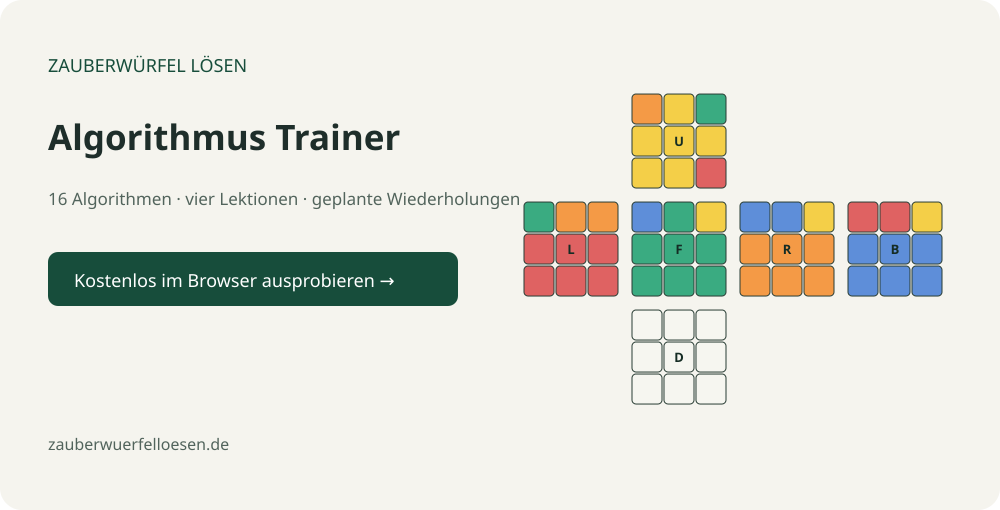

# Cube Algorithm Trainer

Learn **all 16 algorithms for two-look OLL and PLL**, in German, with calculated cube diagrams and scheduled reviews.

**[Open the live trainer →](https://zauberwuerfelloesen.github.io/cube-algorithm-trainer/)** · [Project website](https://zauberwuerfelloesen.de/) · [Changelog](CHANGELOG.md)



## Four lessons
1. **Yellow cross** — line, L-shape and dot (3 cases).
2. **Corner orientation** — Sune, Anti-Sune, H, Pi, U, T and L (7 cases).
3. **Corner permutation** — T and Y (2 cases).
4. **Edge permutation** — Ua, Ub, H and Z (4 cases).

Start after the first two layers are solved. Each lesson explains its prerequisite and goal. Every diagram is computed by applying the inverse of the displayed algorithm to a solved cube; it is a representative case, not every possible arrangement of the irrelevant pieces. U is yellow, F green and R orange. Compare the relevant stickers and use U adjustments when solving arbitrary last-layer cases.

## Practice and review
- Stopwatch, Space shortcut, lesson filters and free-practice mode.
- “Again” schedules 10 minutes; “with help” schedules one day.
- Consecutive successful recalls schedule 1, 3, 7, 14, 30 and then 60 days.
- Reviews follow the earliest due case; unseen cases are immediately available.
- Ratings are self-assessed. The app cannot inspect your physical cube.

## Your progress
No accounts, analytics, cookies, network services or dependencies. Progress is stored locally in your browser under the original storage key, so existing users retain their attempts.

Export JSON to move progress to another device. Import accepts version 1 or 2 exports, rejects malformed data and files over 1 MB, and keeps the most recently reviewed record for each case. Importing merges records; it does not add attempt counters together. If timestamps match, the higher attempt count wins. Back up before resetting or clearing browser data. Review dates use your device clock and timezone.

## Run and contribute
Open `index.html`, or serve the repository with any static HTTP server. No build or installation is needed. HTTP hosting is recommended for predictable browser storage.

```sh
node test.js
```

Tests cover move inverses, wide/slice moves, all 16 setup sequences, F2L preservation, complete two-look orientation and permutation coverage, SVG sticker count, review scheduling, migration, input limits and conflict handling.

Files: `cube.js` is the immutable sticker model and SVG renderer; `app.js` contains lessons, scheduling and the interface. Changes should include focused tests for algorithm or data behavior. File an issue with the case, browser, reproduction steps and expected behavior.

## References
Algorithm sequences were cross-checked against [J Perm’s OLL reference](https://jperm.net/algs/2look/oll) and [CubeSkills PLL algorithms](https://www.cubeskills.com/uploads/pdf/tutorials/pll-algorithms.pdf). Descriptions, software and calculated diagrams are independently written. Z includes its final U adjustment so the prepared example solves exactly.

## More from Zauberwürfel lösen
[German cube guides](https://zauberwuerfelloesen.de/) · [Algorithms](https://zauberwuerfelloesen.de/algorithmen/) · [Cube Pattern Explorer](https://github.com/zauberwuerfelloesen/cube-pattern-explorer)

## License
[MIT](LICENSE).

